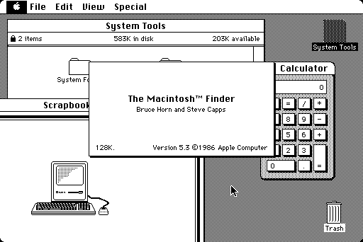

# PiMac 2040 - Apple Macintosh 128K/208K para RP2040-Zero
### Desarrollo, Adaptación e Ingeniería por [SCHUBIGER.CL](https://schubiger.cl)



**PiMac 2040** es una reconstrucción fiel, minimalista y de bajísimo costo del emblemático computador **Apple Macintosh de 1984** ejecutándose sobre el microcontrolador **Raspberry Pi RP2040** en la placa de desarrollo ultracompacta **Waveshare RP2040-Zero** (y sus variantes de AliExpress).

Este proyecto incorpora un **motor de video dual inteligente** (Video Compuesto analógico para televisores antiguos CRT y salida VGA para monitores de PC), expansión de memoria a **208 KB de RAM**, soporte de almacenamiento en tarjeta **MicroSD** mediante un adaptador pasivo soldado directo, retroalimentación visual mediante el **LED RGB WS2812** integrado y conectividad **USB Host**.

---

## 🚀 Características Principales

* **Motor de Video Dual Seleccionable (Compuesto y VGA):**
  * **Video Compuesto (CVBS / RCA):** Modo entrelazado 480i NTSC a $15,734\text{ Hz}$ con DAC pasivo de 2 resistencias. Imagen centrada de $512 \times 342$ píxeles para televisores CRT de tubo.
  * **Salida VGA (DB-15):** Modo estándar $640 \times 480$ a $60\text{ Hz}$ ($31,468\text{ Hz}$) para monitores de computadora LCD o CRT.
  * **Conmutación por Jumper (GP0):** Sin jumper arranca en Compuesto; con jumper a GND arranca en VGA. Ambos conectores pueden estar permanentemente soldados en el mismo aparato.
* **Memoria Expandida a 208 KB ("Mac 208K"):** Aprovecha al máximo la memoria SRAM del RP2040, permitiendo abrir y trabajar sin errores de memoria en **MacPaint 1.5** y **MacWrite 4.5**.
* **Almacenamiento en Tarjeta MicroSD (FAT32):** Lee y escribe permanentemente imágenes de disco (`umac0.img`) a través del bus SPI. Puedes guardar documentos, dibujos y estados de juegos.
* **Lector MicroSD Directo (Sin módulos caros):** Permite soldar cables finos directamente a los contactos dorados de cualquier adaptador plástico MicroSD-a-SD convencional.
* **Controlador USB Host Integrado:** Soporte para mouse y teclado USB estándar mediante el puerto USB-C nativo (o puertos USB-A hembra directos soldados a los pines de la placa).
* **Indicador de Estado Retro (LED RGB WS2812 en GP16):** Muestra el estado del sistema en tiempo real:
  * 🟦 **Azul Celeste:** Inicialización de hardware / POST.
  * 🟨 **Ámbar Intermitente (1 Hz):** Esperando disco (icono clásico del disquete `?`).
  * 🟧 **Naranja Pulsante:** Booteando el sistema (Happy Mac / carga de kernel).
  * 🟩 **Verde Retro Apple (Respiración):** Escritorio / Finder listo para usar.
  * ⚡ **Destello Ámbar Rápido:** Lectura de sectores en la MicroSD.
  * 🟣 **Destello Magenta:** Escritura de sectores en la MicroSD.
  * 🔴 **Rojo Estroboscópico:** Pánico de sistema / Sad Mac / Bomba.
* **Costo Total Ultrabajo:** Todo el proyecto se construye por menos de **$5 a $8 dólares estadounidenses (USD)**.

---

## 🗺️ Mapa de Pines de la RP2040-Zero

```text
                             +-------------------+
                             |     [ USB-C ]     |
                             |  (Host / Flashing)|
   (JUMPER VGA) GP0  [Pin 1] [| 1              20 |] [Pin 20] 5V (VBUS)   ---> +5V USB / Alimentación Externa
        (Libre) GP1  [Pin 2] [| 2              19 |] [Pin 19] GND         ---> Masa General (Tierra)
 (SD Clock) SCK GP2  [Pin 3] [| 3              18 |] [Pin 18] 3V3         ---> Pin 4 (VDD 3.3V) MicroSD
  (SD MOSI) TX  GP3  [Pin 4] [| 4              17 |] [Pin 17] GP29 (HS)   ---> Pin 13 (HSync) VGA DB-15
  (SD MISO) RX  GP4  [Pin 5] [| 5              16 |] [Pin 16] GP28 (CLK)  ---> (Opcional)
    (SD CS) CS  GP5  [Pin 6] [| 6              15 |] [Pin 15] GP27 (VS)   ---> Pin 14 (VSync) VGA DB-15
        (Libre) GP6  [Pin 7] [| 7              14 |] [Pin 14] GP26 (Video)---> Pines 1, 2, 3 (RGB) VGA DB-15
        (Libre) GP7  [Pin 8] [| 8              13 |] [Pin 13] GP15        ---> (Libre)
 (CVBS Sync)    GP8  [Pin 9] [| 9              12 |] [Pin 12] GP14        ---> (Libre)
 (CVBS Video)   GP9  [Pin 10][| 10             11 |] [Pin 11] GP13 (D- M) ---> Pin 2 (D-) USB Mouse
                             +--[10][11][12]-----+
                                  |   |   |
                                  |   |   +--> GP12 (D+ M): Pin 3 (D+) USB Mouse
                                  |   +------> GP11 (D- K): Pin 2 (D-) USB Teclado
                                  +----------> GP10 (D+ K): Pin 3 (D+) USB Teclado
```

---

## 📐 Conexiones Rápidas de Video

### 1. Salida de Video Compuesto (RCA Amarillo para TV CRT)
* **GP8 (Sync):** Resistencia de **$560\ \Omega$** (o $470\ \Omega$) conectada al pin central del RCA.
* **GP9 (Data):** Resistencia de **$270\ \Omega$** (o $240\ \Omega$) conectada al pin central del RCA.
* **GND:** Conectado directamente a la malla exterior del conector RCA.

### 2. Salida VGA (Conector DB-15 Hembra)
* **GP26 (Video):** Resistencia de **$100\ \Omega$ a $120\ \Omega$** conectada a los pines **1, 2 y 3** (Rojo, Verde y Azul unidos).
* **GP27 (VSync):** Conectado directamente al pin **14** del VGA.
* **GP29 (HSync):** Conectado directamente al pin **13** del VGA.
* **GND:** Conectado a los pines **5, 6, 7, 8 y 10** del VGA.
* **Conmutación:** Si colocas un jumper entre **GP0** y **GND**, el sistema arranca automáticamente en modo VGA.

---

## ⚡ Guía de Instalación Rápida (10 Segundos)

1. Descarga el archivo de firmware listo para usar: [`release/PiMac2040_DualVideo_RP2040Zero.uf2`](release/PiMac2040_DualVideo_RP2040Zero.uf2).
2. Mantén presionado el botón **BOOT** de la RP2040-Zero y conéctala a tu computadora por USB.
3. Se abrirá la unidad de almacenamiento llamada **`RPI-RP2`**.
4. Arrastra el archivo `.uf2` dentro de la unidad. La placa se reiniciará sola.
5. Copia cualquiera de las imágenes de disco de la carpeta [`disks/`](disks/) a la raíz de tu tarjeta MicroSD (formateada en FAT32) y renómbrala a **`umac0.img`**.
6. Conecta tu televisor o monitor y disfruta del clásico Macintosh de 1984.

---

## 💽 Colección de Imágenes de Disco Listas para Usar

En la carpeta [`disks/`](disks/) encontrarás una variedad completa de imágenes listas para MicroSD con soporte de lectura y escritura:

| Imagen | Tamaño | SO | Contenido y Aplicaciones Destacadas |
| :--- | :---: | :---: | :--- |
| **`umac0_oficina_almacenamiento_20mb.img`** | **20 MB** | System 3.2 | **Productividad y Almacenamiento:** Microsoft Word 4.0a, Microsoft Excel 2.2a, Microsoft Works 3.0, Aldus PageMaker 2.0a, MacPaint 2.0, MacDraw 1.9, TeachText, BBEdit Lite, utilitarios y carpeta **📁 Mis Documentos** con más de 10 MB libres para tus archivos. |
| **`umac0_master_10mb.img`** | 10 MB | System 3.2 | **Todo-en-Uno:** Dark Castle, Beyond Dark Castle, Stunt Copter, Shufflepuck Café, Risk, Cannon Fodder, Tetris DA, MacPaint, MacDraw, TeachText, Disk Copy, Utilitarios. |
| **`umac0.img`** | 10 MB | System 3.2 | **Clásico Original:** MacPaint 1.3, MacWrite 4.5, MacDraw, Lode Runner, Aliens, Billiard Parlour, Mouse Eaters, DaliClock, Planetfall, MacLanding, Enigma. |
| **`umac0_games_pack.img`** | 4 MB | System 3.2 | **Arcade Pack:** Dark Castle v1.2, Beyond Dark Castle, Stunt Copter, Shufflepuck Café, Risk, Cannon Fodder, Tetris DA. |
| **`umac0_productivity.img`** | 800 KB | System 3.2 | **Oficina y Diseño:** MacPaint, MacDraw, TeachText, Disk Copy, Draw Tour, Woodblock. |
| **`umac0_dark_castle.img`** | 800 KB | Autónomo | **Dark Castle v1.2:** Aventura mítica de plataformas de Silicon Beach Software. |
| **`umac0_beyond_dark_castle.img`** | 800 KB | Autónomo | **Beyond Dark Castle:** Secuela con helicóptero, bombas y salas secretas. |
| **`umac0_stunt_copter.img`** | 800 KB | Autónomo | **Stunt Copter:** Físicas clásicas de Duane Blehm (v1.0 a 2.0). |
| **`umac0_system11_1984.img`** | 400 KB | System 1.1 | **Macintosh 128K 1984:** El sistema original con el que Steve Jobs presentó la Mac en 1984. |
| **`umac0_system32_utilities.img`** | 800 KB | System 3.2 | **Apple Utilities:** Font/DA Mover, Fuentes históricas y herramientas oficiales de disco. |

> [!TIP]
> **Para cambiar de disco:** Consulta la [**Guía Completa de Discos MicroSD**](GUIA_MICROSD_DISCOS.md) para aprender a formatear, copiar y alternar entre los diferentes sistemas y guardar partidas.

---

## 🛠️ Código Fuente y Modificaciones

Este repositorio incluye el código fuente completo en C/C++ y PIO (`src/`, `include/`, `external/`, `tools/` y `CMakeLists.txt`) para que cualquier desarrollador pueda estudiar, compilar y expandir las capacidades del sistema:

* [**Guía de Compilación y Arquitectura del Código**](GUIA_COMPILACION.md): Instrucciones paso a paso para compilar con Pico SDK y Ninja en Windows y Linux.
* **Módulos Editables:**
  * [`src/video_manager.c`](src/video_manager.c): Lógica de conmutación de video y detección de jumpers.
  * [`src/video_composite.c`](src/video_composite.c): Temporización y señales analógicas NTSC 480i.
  * [`src/mac_status.c`](src/mac_status.c): Animaciones y colores del LED RGB WS2812.
  * [`src/hid.c`](src/hid.c): Mapeo de teclas y eventos de mouse USB.

---

## 📚 Documentación Adicional

* [**Guía de Uso e Instalación de Discos en Tarjeta MicroSD**](GUIA_MICROSD_DISCOS.md)
* [**Guía de Compilación desde el Código Fuente**](GUIA_COMPILACION.md)
* [**Lista de Materiales (BOM) y Dónde Comprar Económico**](BOM_LISTA_MATERIALES.md)
* [**Guía Completa de Conexiones Hardware y Pinout**](GUIA_HARDWARE_PINOUT.md)

---

## 📜 Licencia y Uso del Proyecto

Este proyecto se comparte de manera abierta con la comunidad bajo la **Licencia MIT**.

Eres bienvenido a explorar, utilizar, modificar y adaptar libremente tanto el software como el diseño de hardware para tus propios proyectos, estudios o desarrollos personales y comerciales. Si decides construir sobre este trabajo o compartirlo con otros, te agradecemos incluir una referencia o mención al desarrollo original de [SCHUBIGER.CL](https://schubiger.cl).

Para más detalles sobre los términos generales de la licencia, puedes consultar el archivo [LICENSE](LICENSE).
