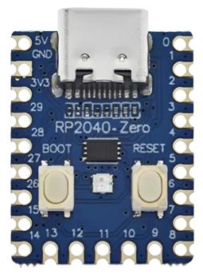

# PiMac 2040 - Apple Macintosh 128K/208K für RP2040-Zero
### Entwicklung, Anpassung und Hardware-Design von [SCHUBIGER.CL](https://schubiger.cl)

<p align="center">
  <strong>🌐 Sprachen / Languages / Idiomas / 语言 / Langues:</strong><br>
  <a href="README.md">🇪🇸 Español</a> |
  <a href="README_EN.md">🇬🇧 English</a> |
  <a href="README_PT.md">🇵🇹 Português</a> |
  <a href="README_DE.md"><strong>🇩🇪 Deutsch</strong></a> |
  <a href="README_ZH.md">🇨🇳 中文</a> |
  <a href="README_FR.md">🇫🇷 Français</a>
</p>

<p align="center">
  
  &nbsp;&nbsp;&nbsp;&nbsp;
  
</p>

> [!TIP]
> **Möchten Sie das System in 5 Minuten aufbauen und testen?**
> Lesen Sie die [**Schnellanleitung für Release und Hardware-Aufbau (RELEASE_README_DE.md)**](RELEASE_README_DE.md) mit einfachen Schritt-für-Schritt-Anweisungen zum Flashen des RP2040, zur Vorbereitung der MicroSD-Karte und zur Auswahl zwischen **Version 1 (Nur Composite-Video)** oder **Version 2 (Dual VGA + Composite)** inklusive vollständiger Stückliste (BOM).

**PiMac 2040** ist eine originalgetreue, minimalistische und extrem kostengünstige Nachbildung des legendären **Apple Macintosh von 1984**, basierend auf dem **Raspberry Pi RP2040** Mikrocontroller auf der ultrakompakten Entwicklungsplatine **Waveshare / Tenstar Robot RP2040-Zero** (und baugleichen Modellen von AliExpress).

Das Projekt umfasst eine **intelligente Dual-Video-Engine** (analoges Composite-Video für klassische Röhrenfernseher und VGA-Ausgang für PC-Monitore), eine Speichererweiterung auf **208 KB RAM**, dauerhaften **MicroSD-Speicher** über einen direkt handgelöteten passiven Adapter, Echtzeit-Hardwarestatus über die integrierte **WS2812 RGB-LED** und native **USB-Host-Unterstützung**.

---

## 🚀 Hauptmerkmale

* **Wählbare Dual-Video-Engine (Composite & VGA):**
  * **Composite-Video (CVBS / Cinch):** Interlaced 480i NTSC-Modus bei 15,734 kHz über einen passiven 2-Widerstands-DAC. Zentriertes Bild mit $512 \times 342$ Pixeln für Röhrenfernseher (CRT).
  * **VGA-Ausgang (DE-15 / DB-15):** Standard $640 \times 480$ bei $60\text{ Hz}$ (31,468 kHz) für PC-Monitore (LCD oder Röhre).
  * **Umschaltung per Jumper / Schalter (GP0):** Ohne Jumper startet das System im Composite-Modus; mit Jumper auf GND startet es im VGA-Modus. Beide Anschlüsse können dauerhaft verlötet bleiben.
* **Erweiterter 208 KB Arbeitsspeicher ("Mac 208K"):** Schöpft das SRAM des RP2040 optimal aus und ermöglicht fehlerfreies Arbeiten in **MacPaint 1.5** und **MacWrite 4.5** ohne Speichermangel.
* **MicroSD-Speicher (FAT32):** Liest und schreibt Rohdatenabbilder (`umac0.img`) direkt über den SPI-Bus. Dokumente, Grafiken und Spielstände werden dauerhaft gesichert.
* **Direkter DIY-MicroSD-Hack (Keine teuren Module):** Es werden lediglich 6 dünne Drähte direkt an die goldenen Kontaktfinger auf der Rückseite eines handelsüblichen MicroSD-zu-SD-Adapters gelötet.
* **Integrierter USB-Host-Controller:** Unterstützung für handelsübliche USB-Tastaturen und -Mäuse über den USB-C-Anschluss (oder recycelte USB-A-Buchsen direkt an den GPIO-Pins).
* **Retro-Statusdiagnose über RGB-LED (WS2812 an GP16):**
  * 🟦 **Himmelblau:** Hardware-Initialisierung / POST.
  * 🟨 **Blinkendes Bernstein (1 Hz):** Warten auf Diskette (klassisches `?`-Diskettensymbol).
  * 🟧 **Pulsierendes Orange:** Systemstart (Happy Mac / Laden des Kernels).
  * 🟩 **Apple Retro-Grün (Atmend):** Desktop / Finder betriebsbereit.
  * ⚡ **Schnelles Bernstein-Blitzen:** Sektoren von MicroSD lesen.
  * 🟪 **Magenta-Blitzen:** Sektoren auf MicroSD schreiben.
  * 🔴 **Stroboskop-Rot:** System-Panic / Sad Mac / Bomben-Fehler.
* **Extrem niedrige Gesamtkosten:** Das gesamte Projekt lässt sich für unter **5 bis 8 US-Dollar (USD)** realisieren.

---

## 🗺️ Pinbelegung des RP2040-Zero

<p align="center">
  <br>
  <em>Offizielle Hardware-Platine: Tenstar Robot / Waveshare RP2040-Zero (18 × 23,5 mm)</em>
</p>

```text
                            +-------------------+
                            |     [ USB-C ]     |
                            | (Host OTG/Flashing|
   +5V (VBUS / 5V DC Ext) 5V [ | (o)           (o) | ] 0   GP0 (Wahlschalter VGA/RCA)
          GND (Hauptmasse) GND[ | (o)           (o) | ] 1   GP1 (Frei)
(Pin 4 VDD 3.3V MicroSD) 3V3[ | (o)           (o) | ] 2   GP2 (SD CLK - Takt)
    (HSync VGA DB-15 p.13) 29 [ | (o)  RP2040   (o) | ] 3   GP3 (SD TX - MOSI)
         (Optionaler Takt)28 [ | (o)   -Zero   (o) | ] 4   GP4 (SD RX - MISO)
    (VSync VGA DB-15 p.14) 27 [ | (o)  +-----+  (o) | ] 5   GP5 (SD CS - Chip Select)
 (Video VGA 100Ω p.1,2,3) 26 [ | (o)           (o) | ] 6   GP6 (Frei)
                 (Frei)   15 [ | (o) [BOOT] [RST] (o)| ] 7   GP7 (Frei)
                 (Frei)   14 [ | (o)           (o) | ] 8   GP8 (CVBS Sync 560Ω -> RCA)
                               +-------------------+
                                  13  12  11  10  9
                                   |   |   |   |  +--> GP9  (CVBS Video 270Ω -> RCA)
                                   |   |   |   +-----> GP10 (USB Tastatur D+)
                                   |   |   +---------> GP11 (USB Tastatur D-)
                                   |   +-------------> GP12 (USB Maus D+)
                                   +-----------------> GP13 (USB Maus D-)
```

---

## 📺 Schnelle Video-Verdrahtung

### Version 1: Nur Composite-Video (Gelbe Cinch-Buchse für Röhren-TVs)
[](assets/pimac2040_version1_composite.jpg)

* **GP8 (Sync):** **$560\,\Omega$** Widerstand (1/4 W, Grün-Blau-Braun) an den Mittelpin der Cinch-Buchse.
* **GP9 (Data):** **$270\,\Omega$** Widerstand (1/4 W, Rot-Violett-Braun) an den Mittelpin der Cinch-Buchse.
* **GND:** Direkt an das äußere Metallgehäuse / Masse der Cinch-Buchse.

---

### Version 2: Dual VGA + Composite-Video (PC-Monitor und Röhren-TV)
[](assets/pimac2040_version2_dual_vga_composite.jpg)

* **GP26 (Monochrom-Video):** **$100\,\Omega$** Widerstand (1/4 W, Braun-Schwarz-Braun) an die Pins **1, 2 und 3 (Rot, Grün und Blau verbunden)** der VGA DE-15 Buchse.
* **GP27 (VSync):** Direkt an Pin **14** der VGA-Buchse.
* **GP29 (HSync):** Direkt an Pin **13** der VGA-Buchse.
* **GND:** An die Pins **5, 6, 7, 8 und 10** der VGA-Buchse.
* **Umschaltung:** Schalter oder Jumper zwischen **GP0** und **GND**: verbunden mit GND startet im VGA-Modus; offen startet im Composite-Modus.

---

## ⚡ 10-Sekunden-Schnellinstallationsanleitung

1. Laden Sie die fertige Firmware-Datei herunter: [`release/PiMac2040_DualVideo_RP2040Zero.uf2`](release/PiMac2040_DualVideo_RP2040Zero.uf2).
2. Halten Sie die Taste **BOOT** auf dem RP2040-Zero gedrückt und schließen Sie ihn per USB an den PC an.
3. Es öffnet sich ein Wechsellaufwerk namens **`RPI-RP2`**.
4. Ziehen Sie die `.uf2`-Datei auf das Laufwerk. Die Platine flasht sich und startet automatisch neu.
5. Kopieren Sie ein beliebiges Disk-Image aus dem Ordner [`disks/`](disks/) auf die FAT32-formatierte MicroSD-Karte und benennen Sie es in **`umac0.img`** um.
6. Schließen Sie Monitor oder Fernseher an und erleben Sie den Macintosh von 1984!

---

## 💾 Katalog der einsatzbereiten Disk-Images

Im Ordner [`disks/`](disks/) finden Sie vorkonfigurierte Disk-Images mit vollständiger Schreib- und Leseunterstützung:

| Image | Größe | OS | Enthaltene Software & Highlights |
| :--- | :---: | :---: | :--- |
| **`umac0_oficina_almacenamiento_20mb.img`** | **20 MB** | System 3.2 | **Produktivität & Speicher:** Microsoft Word 4.0a, Microsoft Excel 2.2a, Microsoft Works 3.0, Aldus PageMaker 2.0a, MacPaint 2.0, MacDraw 1.9, TeachText, BBEdit Lite, Dienstprogramme und **📁 Meine Dokumente** mit über 10 MB freiem Speicher. |
| **`umac0_aventura_juegos_15mb.img`** | **15 MB** | System 3.2 | **Abenteuer & Strategie:** Prince of Persia (SW), SimCity 1.11 mit Szenarien, offizielles Tetris mit Sound, Dark Castle, Beyond Dark Castle, Stunt Copter, Shufflepuck Café, Risk, Cannon Fodder und **📁 Meine Spielstände** mit über 8 MB freiem Speicher. |
| **`umac0_master_10mb.img`** | 10 MB | System 3.2 | **Alles-in-Einem:** Dark Castle, Beyond Dark Castle, Stunt Copter, Shufflepuck Café, Risk, Cannon Fodder, Tetris DA, MacPaint, MacDraw, TeachText, Disk Copy, Utilities. |
| **`umac0.img`** | 10 MB | System 3.2 | **Original-Klassiker:** MacPaint 1.3, MacWrite 4.5, MacDraw, Lode Runner, Aliens, Billiard Parlour, Mouse Eaters, DaliClock, Planetfall, MacLanding, Enigma. |
| **`umac0_games_pack.img`** | 4 MB | System 3.2 | **Arcade-Paket:** Dark Castle v1.2, Beyond Dark Castle, Stunt Copter, Shufflepuck Café, Risk, Cannon Fodder, Tetris DA. |
| **`umac0_productivity.img`** | 800 KB | System 3.2 | **Büro & Design:** MacPaint, MacDraw, TeachText, Disk Copy, Draw Tour, Woodblock. |
| **`umac0_dark_castle.img`** | 800 KB | Eigenständig | **Dark Castle v1.2:** Legendärer Plattformer von Silicon Beach Software. |
| **`umac0_beyond_dark_castle.img`** | 800 KB | Eigenständig | **Beyond Dark Castle:** Geniale Fortsetzung mit Jetpack, Bomben und Geheimräumen. |
| **`umac0_stunt_copter.img`** | 800 KB | Eigenständig | **Stunt Copter:** Physik-Klassiker von Duane Blehm (v1.0 bis 2.0). |
| **`umac0_system11_1984.img`** | 400 KB | System 1.1 | **Macintosh 128K 1984:** Das historische Originalsystem der Steve-Jobs-Präsentation. |
| **`umac0_system32_utilities.img`** | 800 KB | System 3.2 | **Apple Utilities:** Font/DA Mover, historische Schriftarten und System-Tools. |

> [!TIP]
> **Disketten wechseln:** Lesen Sie die [**Vollständige Anleitung zu MicroSD-Disks (disks/README_DE.md)**](disks/README_DE.md) zum Formatieren, Kopieren und Verwalten von Spielständen.

---

## 💻 Quellcode und Architektur

Der vollständige Quellcode befindet sich im Verzeichnis [`src/`](src/):
* [`src/main.c`](src/main.c): Einstiegspunkt, 240-MHz-Overclocking, Speicherinitialisierung und Hauptschleife.
* [`src/mac_display_composite.c`](src/mac_display_composite.c): DMA-gestützter NTSC 480i Monochrom-Composite-Videotreiber.
* [`src/mac_display.c`](src/mac_display.c): Standard 640x480 @ 60Hz VGA-Videotreiber.
* [`src/mac_status.c`](src/mac_status.c): WS2812 RGB-LED Farbstatus- und Animationstreiber.
* [`src/hid.c`](src/hid.c): USB-Tastatur- und Maus-Event-Mappping.

---

## 📚 Zusätzliche Dokumentation

* [**Schnellanleitung für Release & Hardware-Aufbau**](RELEASE_README_DE.md)
* [**MicroSD-Disks & Image-Verwaltung**](disks/README_DE.md)
* [**Hardware-Pinbelegung & Verdrahtungsplan**](GUIA_HARDWARE_PINOUT.md)
* [**Firmware-Kompilierungsanleitung**](GUIA_COMPILACION.md)
* [**Stückliste (BOM) & Einkaufsführer**](BOM_LISTA_MATERIALES.md)

---

## 📜 Offene Lizenz und Namensnennung

Dieses Projekt wird unter der **MIT-Lizenz** frei mit der weltweiten Maker-Community geteilt.

Sie können sowohl die Software als auch das Hardware-Design für persönliche, schulische oder kommerzielle Zwecke frei studieren, verändern, kompilieren und weitergeben. Bei der Veröffentlichung von Abwandlungen bitten wir um Erwähnung und Verlinkung des Originalprojekts von [SCHUBIGER.CL](https://schubiger.cl).

Die genauen Lizenzbedingungen finden Sie in der Datei [LICENSE](LICENSE).
