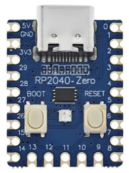

# PiMac 2040 - Apple Macintosh 128K/208K for RP2040-Zero
### Development, Adaptation and Engineering by [SCHUBIGER.CL](https://schubiger.cl)

<p align="center">
  <strong>🌐 Languages / Idiomas / Sprachen / 语言 / Langues:</strong><br>
  <a href="README.md">🇪🇸 Español</a> |
  <a href="README_EN.md"><strong>🇬🇧 English</strong></a> |
  <a href="README_PT.md">🇵🇹 Português</a> |
  <a href="README_DE.md">🇩🇪 Deutsch</a> |
  <a href="README_ZH.md">🇨🇳 中文</a> |
  <a href="README_FR.md">🇫🇷 Français</a>
</p>

<p align="center">
  
  &nbsp;&nbsp;&nbsp;&nbsp;
  
</p>

> [!TIP]
> **Want to build and test it in 5 minutes?**
> Check out the [**Quick Release & Hardware Assembly Guide (RELEASE_README_EN.md)**](RELEASE_README_EN.md), featuring simple step-by-step instructions to flash the RP2040, prepare the MicroSD card, and choose between **Version 1 (Composite Video Only)** or **Version 2 (Dual VGA + Composite)** with full component BOM.

**PiMac 2040** is a faithful, minimalist, and ultra-low-cost recreation of the iconic **1984 Apple Macintosh** computer running on the **Raspberry Pi RP2040** microcontroller inside the ultra-compact **Waveshare / Tenstar Robot RP2040-Zero** development board (and its AliExpress equivalents).

This project incorporates a **smart dual video engine** (analog Composite video for retro CRT TVs and VGA output for PC monitors), memory expansion to **208 KB of RAM**, persistent **MicroSD card** storage via a direct hand-soldered passive adapter, real-time hardware status feedback via the onboard **WS2812 RGB LED**, and native **USB Host** connectivity.

---

## 🚀 Key Features

* **Selectable Dual Video Engine (Composite & VGA):**
  * **Composite Video (CVBS / RCA):** Interlaced 480i NTSC mode at 15.734 kHz using a passive 2-resistor DAC. Centered display of $512 \times 342$ pixels for vintage CRT tube televisions.
  * **VGA Output (DE-15 / DB-15):** Standard $640 \times 480$ @ $60\text{ Hz}$ (31.468 kHz) for LCD or CRT PC monitors.
  * **Hardware Mode Switching (GP0):** Open / No jumper boots into Composite Video; jumper to GND boots into VGA. Both video ports can remain permanently soldered to the same unit.
* **Expanded 208 KB RAM ("Mac 208K"):** Fully optimizes the RP2040's SRAM memory, allowing you to run and work without out-of-memory errors in **MacPaint 1.5** and **MacWrite 4.5**.
* **MicroSD Storage (FAT32):** Reads and writes raw disk images (`umac0.img`) directly over the SPI bus. You can save documents, artwork, and game save files persistently.
* **Direct DIY MicroSD Hack (No expensive modules):** Simply solder 6 thin wires directly to the gold contact fingers on the back of any standard plastic MicroSD-to-SD adapter sleeve.
* **Integrated USB Host Controller:** Standard USB mouse and keyboard support via the native USB-C port (or direct recycled female USB-A jacks soldered to GPIO pins).
* **Retro RGB Status Diagnostics (WS2812 on GP16):** Real-time visual feedback:
  * 🟦 **Sky Blue:** Hardware initialization / POST.
  * 🟨 **Flashing Amber (1 Hz):** Waiting for disk (classic `?` floppy icon).
  * 🟧 **Pulsing Orange:** Booting system (Happy Mac / kernel load).
  * 🟩 **Apple Retro Green (Breathing):** Desktop / Finder ready for use.
  * ⚡ **Fast Amber Flash:** Reading sectors from MicroSD.
  * 🟪 **Magenta Flash:** Writing sectors to MicroSD.
  * 🔴 **Strobe Red:** System Panic / Sad Mac / Bomb error.
* **Ultra-Low BOM Cost:** Build the entire retrocomputer for under **$5 to $8 USD**.

---

## 🗺️ RP2040-Zero Pinout Map

<p align="center">
  <br>
  <em>Official project hardware: Tenstar Robot / Waveshare RP2040-Zero (18 × 23.5 mm)</em>
</p>

```text
                            +-------------------+
                            |     [ USB-C ]     |
                            | (Host OTG/Flashing|
   +5V (VBUS / 5V DC Ext) 5V [ | (o)           (o) | ] 0   GP0 (Selector VGA/RCA Switch)
         GND (Main Ground) GND [ | (o)           (o) | ] 1   GP1 (Free)
(Pin 4 VDD 3.3V MicroSD) 3V3[ | (o)           (o) | ] 2   GP2 (SD CLK - Clock)
    (HSync VGA DB-15 p.13) 29 [ | (o)  RP2040   (o) | ] 3   GP3 (SD TX - MOSI)
         (Optional CLK)   28 [ | (o)   -Zero   (o) | ] 4   GP4 (SD RX - MISO)
    (VSync VGA DB-15 p.14) 27 [ | (o)  +-----+  (o) | ] 5   GP5 (SD CS - Chip Select)
 (Video VGA 100Ω p.1,2,3) 26 [ | (o)           (o) | ] 6   GP6 (Free)
                 (Free)   15 [ | (o) [BOOT] [RST] (o)| ] 7   GP7 (Free)
                 (Free)   14 [ | (o)           (o) | ] 8   GP8 (CVBS Sync 560Ω -> RCA)
                               +-------------------+
                                  13  12  11  10  9
                                   |   |   |   |  +--> GP9  (CVBS Video 270Ω -> RCA)
                                   |   |   |   +-----> GP10 (USB Keyboard D+)
                                   |   |   +---------> GP11 (USB Keyboard D-)
                                   |   +-------------> GP12 (USB Mouse D+)
                                   +-----------------> GP13 (USB Mouse D-)
```

---

## 📺 Quick Video Connections

### Version 1: Composite Video Only (Yellow RCA Jack for CRT TVs)
[](assets/pimac2040_version1_composite.jpg)

* **GP8 (Sync):** **$560\,\Omega$** resistor (1/4 W, Green-Blue-Brown) connected to the center pin of the RCA jack.
* **GP9 (Data):** **$270\,\Omega$** resistor (1/4 W, Red-Violet-Brown) connected to the center pin of the RCA jack.
* **GND:** Connected directly to the outer shield / chassis of the RCA jack.

---

### Version 2: Dual VGA + Composite Video (PC Monitor & CRT TV)
[](assets/pimac2040_version2_dual_vga_composite.jpg)

* **GP26 (Monochrome Video):** **$100\,\Omega$** resistor (1/4 W, Brown-Black-Brown) connected to pins **1, 2, and 3 (Red, Green, Blue tied together)** of the VGA DE-15 female connector.
* **GP27 (VSync):** Connected directly to pin **14** of the VGA connector.
* **GP29 (HSync):** Connected directly to pin **13** of the VGA connector.
* **GND:** Connected to pins **5, 6, 7, 8, and 10** of the VGA connector.
* **Switching:** Connect an SPDT switch or jumper between **GP0** and **GND**: closed to GND boots into VGA mode; open boots into Composite Video mode.

---

## ⚡ Quick 10-Second Installation Guide

1. Download the pre-compiled firmware UF2 file: [`release/PiMac2040_DualVideo_RP2040Zero.uf2`](release/PiMac2040_DualVideo_RP2040Zero.uf2).
2. Hold down the **BOOT** button on the RP2040-Zero and plug it into your computer via USB.
3. A mass storage drive named **`RPI-RP2`** will appear on your desktop.
4. Drag and drop the `.uf2` file onto the drive. The board will flash and reboot automatically.
5. Copy any disk image from the [`disks/`](disks/) directory to the root of a FAT32-formatted MicroSD card and rename it to **`umac0.img`**.
6. Connect your monitor or TV and enjoy the classic 1984 Macintosh!

---

## 💾 Ready-to-Use Disk Images Catalog

The [`disks/`](disks/) folder contains ready-to-use disk images with full read/write support:

| Image | Size | OS | Featured Software & Highlights |
| :--- | :---: | :---: | :--- |
| **`umac0_oficina_almacenamiento_20mb.img`** | **20 MB** | System 3.2 | **Productivity & Storage:** Microsoft Word 4.0a, Microsoft Excel 2.2a, Microsoft Works 3.0, Aldus PageMaker 2.0a, MacPaint 2.0, MacDraw 1.9, TeachText, BBEdit Lite, utilities and **📁 My Documents** folder with over 10 MB free. |
| **`umac0_aventura_juegos_15mb.img`** | **15 MB** | System 3.2 | **Adventure & Strategy Games:** Prince of Persia (BW), SimCity 1.11 with scenarios, official Tetris with audio, Dark Castle, Beyond Dark Castle, Stunt Copter, Shufflepuck Café, Risk, Cannon Fodder and **📁 My Savegames** folder with over 8 MB free. |
| **`umac0_master_10mb.img`** | 10 MB | System 3.2 | **All-in-One Pack:** Dark Castle, Beyond Dark Castle, Stunt Copter, Shufflepuck Café, Risk, Cannon Fodder, Tetris DA, MacPaint, MacDraw, TeachText, Disk Copy, Utilities. |
| **`umac0.img`** | 10 MB | System 3.2 | **Original Classic:** MacPaint 1.3, MacWrite 4.5, MacDraw, Lode Runner, Aliens, Billiard Parlour, Mouse Eaters, DaliClock, Planetfall, MacLanding, Enigma. |
| **`umac0_games_pack.img`** | 4 MB | System 3.2 | **Arcade Pack:** Dark Castle v1.2, Beyond Dark Castle, Stunt Copter, Shufflepuck Café, Risk, Cannon Fodder, Tetris DA. |
| **`umac0_productivity.img`** | 800 KB | System 3.2 | **Office & Design:** MacPaint, MacDraw, TeachText, Disk Copy, Draw Tour, Woodblock. |
| **`umac0_dark_castle.img`** | 800 KB | Standalone | **Dark Castle v1.2:** Legendary Silicon Beach Software action platformer. |
| **`umac0_beyond_dark_castle.img`** | 800 KB | Standalone | **Beyond Dark Castle:** Epic sequel with jetpack, bombs, and secret rooms. |
| **`umac0_stunt_copter.img`** | 800 KB | Standalone | **Stunt Copter:** Classic Duane Blehm physics game (v1.0 to 2.0). |
| **`umac0_system11_1984.img`** | 400 KB | System 1.1 | **Macintosh 128K 1984:** The original system shown by Steve Jobs at the 1984 launch. |
| **`umac0_system32_utilities.img`** | 800 KB | System 3.2 | **Apple Utilities:** Font/DA Mover, vintage fonts, and official disk tools. |

> [!TIP]
> **To switch disks:** See the [**Complete MicroSD Disks Guide (disks/README_EN.md)**](disks/README_EN.md) to learn how to format, copy, swap systems, and save games.

---

## 💻 Source Code & Architecture

Full source code is located in [`src/`](src/):
* [`src/main.c`](src/main.c): Entry point, 240 MHz overclock, memory initialization, and main loop.
* [`src/mac_display_composite.c`](src/mac_display_composite.c): DMA-driven NTSC 480i monochrome composite video generator.
* [`src/mac_display.c`](src/mac_display.c): Standard 640x480 @ 60Hz VGA video controller.
* [`src/mac_status.c`](src/mac_status.c): WS2812 RGB LED color states and animation driver.
* [`src/hid.c`](src/hid.c): USB keyboard scancode and mouse event translator.

---

## 📚 Additional Documentation

* [**Quick Release & Hardware Assembly Guide**](RELEASE_README_EN.md)
* [**MicroSD Disks & Image Management Guide**](disks/README_EN.md)
* [**Hardware Pinout & Wiring Technical Guide**](GUIA_HARDWARE_PINOUT.md)
* [**Firmware Compilation Guide**](GUIA_COMPILACION.md)
* [**Bill of Materials (BOM) & Buying Guide**](BOM_LISTA_MATERIALES.md)

---

## 📜 Open License & Attribution

This project is openly shared with the global maker community under the **MIT License**.

You are completely free to explore, study, modify, manipulate, compile, and redistribute both the software and hardware designs for personal, educational, or commercial purposes. If you build upon this work or redistribute it, we kindly ask that you keep the attribution and citation of the original development by [SCHUBIGER.CL](https://schubiger.cl).

For full legal terms, refer to the [LICENSE](LICENSE) file.
