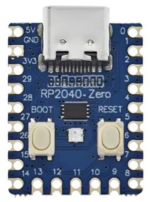

# PiMac 2040 - Apple Macintosh 128K/208K pour RP2040-Zero
### Développement, Adaptation et Ingénierie par [SCHUBIGER.CL](https://schubiger.cl)

<p align="center">
  <strong>🌐 Langues / Languages / Idiomas / Sprachen / 语言:</strong><br>
  <a href="README.md">🇪🇸 Español</a> |
  <a href="README_EN.md">🇬🇧 English</a> |
  <a href="README_PT.md">🇵🇹 Português</a> |
  <a href="README_DE.md">🇩🇪 Deutsch</a> |
  <a href="README_ZH.md">🇨🇳 中文</a> |
  <a href="README_FR.md"><strong>🇫🇷 Français</strong></a>
</p>

<p align="center">
  
  &nbsp;&nbsp;&nbsp;&nbsp;
  
</p>

> [!TIP]
> **Vous souhaitez le monter et le tester en 5 minutes ?**
> Consultez le [**Guide Rapide d'Installation et d'Assemblage Matériel pour la Release (RELEASE_README_FR.md)**](RELEASE_README_FR.md), détaillant étape par étape le flashage du RP2040, la préparation de la carte MicroSD et le choix entre la **Version 1 (Vidéo composite seule)** ou la **Version 2 (Double sortie VGA + Composite)** avec nomenclature complète (BOM).

**PiMac 2040** est une recréation fidèle, minimaliste et à très faible coût de l'emblématique ordinateur **Apple Macintosh de 1984**, fonctionnant sur le microcontrôleur **Raspberry Pi RP2040** au format ultracompact **Waveshare / Tenstar Robot RP2040-Zero** (et ses équivalents disponibles sur AliExpress).

Ce projet intègre un **moteur vidéo double intelligent** (vidéo composite analogique pour téléviseurs cathodiques vintage et sortie VGA pour moniteurs PC), une extension de mémoire à **208 Ko de RAM**, un stockage persistant sur carte **MicroSD** via un adaptateur passif soudé à la main, un diagnostic matériel en temps réel via la **LED RGB WS2812** intégrée et une connectivité **USB Host** native.

---

## 🚀 Caractéristiques Principales

* **Moteur Vidéo Double Sélectionnable (Composite & VGA) :**
  * **Vidéo Composite (CVBS / RCA) :** Mode entrelacé 480i NTSC à 15,734 kHz avec un DAC passif à 2 résistances. Affichage centré de $512 \times 342$ pixels optimisé pour les téléviseurs cathodiques (CRT).
  * **Sortie VGA (DE-15 / DB-15) :** Mode standard $640 \times 480$ à $60\text{ Hz}$ (31,468 kHz) pour écrans PC (LCD ou cathodiques).
  * **Commutation Matérielle par Cavalier / Interrupteur (GP0) :** Sans cavalier, démarrage en vidéo composite ; avec cavalier relié à la masse (GND), démarrage en VGA. Les deux connecteurs peuvent rester soudés en permanence.
* **Mémoire Étendue à 208 Ko (« Mac 208K ») :** Exploite au maximum la mémoire SRAM du RP2040, permettant d'ouvrir et de travailler sans saturation mémoire dans **MacPaint 1.5** et **MacWrite 4.5**.
* **Stockage sur Carte MicroSD (FAT32) :** Lit et écrit directement les images disques brutes (`umac0.img`) via le bus SPI. Sauvegarde durablement vos documents, illustrations et parties de jeux.
* **Hack DIY pour MicroSD (Sans modules onéreux) :** Soudez simplement 6 fils fins directement sur les pistes dorées à l'arrière d'un adaptateur plastique commercial MicroSD vers SD.
* **Contrôleur USB Host Intégré :** Prise en charge des souris et claviers USB standards via le port USB-C natif (ou des ports USB-A femelles de récupération soudés aux broches de la carte).
* **Diagnostic Rétro par LED RGB (WS2812 sur GP16) :**
  * 🟦 **Bleu Ciel :** Initialisation matérielle / POST.
  * 🟨 **Ambre Clignotant (1 Hz) :** En attente de disquette (icône classique de la disquette `?`).
  * 🟧 **Orange Pulsant :** Démarrage du système (Happy Mac / chargement du noyau).
  * 🟩 **Vert Rétro Apple (Respiration) :** Bureau / Finder prêt à l'emploi.
  * ⚡ **Flash Ambre Rapide :** Lecture de secteurs sur la MicroSD.
  * 🟪 **Flash Magenta :** Écriture de secteurs sur la MicroSD.
  * 🔴 **Rouge Stroboscopique :** Erreur critique / Sad Mac / Bombe.
* **Coût Matériel Minime :** L'ensemble du rétro-ordinateur revient à moins de **5 à 8 dollars américains (USD)**.

---

## 🗺️ Brochage (Pinout) du RP2040-Zero

<p align="center">
  <br>
  <em>Carte matérielle officielle du projet : Tenstar Robot / Waveshare RP2040-Zero (18 × 23,5 mm)</em>
</p>

```text
                            +-------------------+
                            |     [ USB-C ]     |
                            | (Host OTG/Flash)  |
   +5V (VBUS / 5V DC Ext) 5V [ | (o)           (o) | ] 0   GP0 (Sélecteur VGA/RCA Switch)
         GND (Masse Générale)  [ | (o)           (o) | ] 1   GP1 (Libre)
(Broche 4 VDD 3.3V MicroSD)3V3[ | (o)           (o) | ] 2   GP2 (SD CLK - Horloge)
    (HSync VGA DB-15 b.13) 29 [ | (o)  RP2040   (o) | ] 3   GP3 (SD TX - MOSI)
         (Horloge Option) 28 [ | (o)   -Zero   (o) | ] 4   GP4 (SD RX - MISO)
    (VSync VGA DB-15 b.14) 27 [ | (o)  +-----+  (o) | ] 5   GP5 (SD CS - Sélection Puce)
 (Vidéo VGA 100Ω b.1,2,3) 26 [ | (o)           (o) | ] 6   GP6 (Libre)
                 (Libre)  15 [ | (o) [BOOT] [RST] (o)| ] 7   GP7 (Libre)
                 (Libre)  14 [ | (o)           (o) | ] 8   GP8 (CVBS Sync 560Ω -> RCA)
                               +-------------------+
                                  13  12  11  10  9
                                   |   |   |   |  +--> GP9  (CVBS Vidéo 270Ω -> RCA)
                                   |   |   |   +-----> GP10 (USB Clavier D+)
                                   |   |   +---------> GP11 (USB Clavier D-)
                                   |   +-------------> GP12 (USB Souris D+)
                                   +-----------------> GP13 (USB Souris D-)
```

---

## 📺 Câblage Vidéo Rapide

### Version 1 : Vidéo Composite Seule (Prise RCA Jaune pour TV Cathodique)
[](assets/pimac2040_version1_composite.jpg)

* **GP8 (Sync) :** Résistance de **$560\,\Omega$** (1/4 W, Vert-Bleu-Marron) reliée à la broche centrale de la prise RCA femelle.
* **GP9 (Data) :** Résistance de **$270\,\Omega$** (1/4 W, Rouge-Violet-Marron) reliée à la broche centrale de la prise RCA femelle.
* **GND :** Relié directement au blindage métallique extérieur de la prise RCA.

---

### Version 2 : Double Sortie VGA + Vidéo Composite (Moniteur PC et TV Cathodique)
[](assets/pimac2040_version2_dual_vga_composite.jpg)

* **GP26 (Vidéo Monochrome) :** Résistance de **$100\,\Omega$** (1/4 W, Marron-Noir-Marron) reliée aux broches **1, 2 et 3 (Rouge, Vert et Bleu reliés ensemble)** du connecteur VGA DE-15 femelle.
* **GP27 (VSync) :** Relié directement à la broche **14** du connecteur VGA.
* **GP29 (HSync) :** Relié directement à la broche **13** du connecteur VGA.
* **GND :** Relié aux broches **5, 6, 7, 8 et 10** du connecteur VGA.
* **Commutation :** Installez un interrupteur SPDT ou cavalier entre **GP0** et **GND** : fermé vers GND démarre en VGA ; ouvert démarre en Vidéo Composite.

---

## ⚡ Guide d'Installation Rapide (10 Secondes)

1. Téléchargez le firmware précompilé prêt à l'emploi : [`release/PiMac2040_DualVideo_RP2040Zero.uf2`](release/PiMac2040_DualVideo_RP2040Zero.uf2).
2. Maintenez enfoncé le bouton **BOOT** du RP2040-Zero et connectez-le à votre ordinateur en USB.
3. Un lecteur amovible nommé **`RPI-RP2`** s'ouvre sur votre bureau.
4. Glissez-déposez le fichier `.uf2` sur le lecteur. La carte flashera le firmware et redémarrera automatiquement.
5. Copiez l'une des images disques du dossier [`disks/`](disks/) à la racine d'une carte MicroSD formatée en FAT32 et renommez-la en **`umac0.img`**.
6. Branchez votre écran ou téléviseur et profitez de l'expérience Macintosh de 1984 !

---

## 💾 Catalogue d'Images Disques Prêtes à l'Emploi

Dans le dossier [`disks/`](disks/), vous trouverez une sélection complète d'images avec support de lecture/écriture :

| Image | Taille | OS | Logiciels Inclus & Points Forts |
| :--- | :---: | :---: | :--- |
| **`umac0_oficina_almacenamiento_20mb.img`** | **20 Mo** | System 3.2 | **Productivité & Stockage :** Microsoft Word 4.0a, Microsoft Excel 2.2a, Microsoft Works 3.0, Aldus PageMaker 2.0a, MacPaint 2.0, MacDraw 1.9, TeachText, BBEdit Lite, utilitaires et dossier **📁 Mes Documents** avec plus de 10 Mo d'espace libre. |
| **`umac0_aventura_juegos_15mb.img`** | **15 Mo** | System 3.2 | **Aventure & Stratégie :** Prince of Persia (NB), SimCity 1.11 complet, Tetris officiel sonorisé, Dark Castle, Beyond Dark Castle, Stunt Copter, Shufflepuck Café, Risk, Cannon Fodder et dossier **📁 Mes Sauvegardes** avec plus de 8 Mo libres. |
| **`umac0_master_10mb.img`** | 10 Mo | System 3.2 | **Tout-en-Un :** Dark Castle, Beyond Dark Castle, Stunt Copter, Shufflepuck Café, Risk, Cannon Fodder, Tetris DA, MacPaint, MacDraw, TeachText, Disk Copy, Utilitaires. |
| **`umac0.img`** | 10 Mo | System 3.2 | **Classique Historique :** MacPaint 1.3, MacWrite 4.5, MacDraw, Lode Runner, Aliens, Billiard Parlour, Mouse Eaters, DaliClock, Planetfall, MacLanding, Enigma. |
| **`umac0_games_pack.img`** | 4 Mo | System 3.2 | **Pack Arcade :** Dark Castle v1.2, Beyond Dark Castle, Stunt Copter, Shufflepuck Café, Risk, Cannon Fodder, Tetris DA. |
| **`umac0_productivity.img`** | 800 Ko | System 3.2 | **Bureautique & Dessin :** MacPaint, MacDraw, TeachText, Disk Copy, Draw Tour, Woodblock. |
| **`umac0_dark_castle.img`** | 800 Ko | Autonome | **Dark Castle v1.2 :** Jeu mythique de plates-formes de Silicon Beach Software. |
| **`umac0_beyond_dark_castle.img`** | 800 Ko | Autonome | **Beyond Dark Castle :** Suite incontournable avec jetpack, bombes et salles secrètes. |
| **`umac0_stunt_copter.img`** | 800 Ko | Autonome | **Stunt Copter :** Jeu d'adresse et de physique de Duane Blehm (v1.0 à 2.0). |
| **`umac0_system11_1984.img`** | 400 Ko | System 1.1 | **Macintosh 128K 1984 :** Le système original présenté par Steve Jobs lors du lancement en 1984. |
| **`umac0_system32_utilities.img`** | 800 Ko | System 3.2 | **Apple Utilities :** Font/DA Mover, polices vintage et outils disques officiels. |

> [!TIP]
> **Pour changer de disquette :** Consultez le [**Guide Complet des Disques MicroSD (disks/README_FR.md)**](disks/README_FR.md) pour apprendre à formater, transférer et sauvegarder vos parties.

---

## 💻 Code Source & Architecture

L'intégralité du code source se trouve dans le répertoire [`src/`](src/) :
* [`src/main.c`](src/main.c) : Point d'entrée, overclocking à 240 MHz, initialisation mémoire et boucle principale.
* [`src/mac_display_composite.c`](src/mac_display_composite.c) : Contrôleur DMA pour signal vidéo composite monochrome NTSC 480i.
* [`src/mac_display.c`](src/mac_display.c) : Contrôleur vidéo VGA standard 640x480 @ 60Hz.
* [`src/mac_status.c`](src/mac_status.c) : Pilote des couleurs et animations de la LED RGB WS2812.
* [`src/hid.c`](src/hid.c) : Traducteur USB pour frappes clavier et mouvements de souris.

---

## 📚 Documentation Complémentaire

* [**Guide Rapide d'Installation et d'Assemblage Matériel**](RELEASE_README_FR.md)
* [**Guide Complet des Images Disques MicroSD**](disks/README_FR.md)
* [**Brochage Matériel et Schéma de Câblage Détaillé**](GUIA_HARDWARE_PINOUT.md)
* [**Guide de Compilation du Firmware**](GUIA_COMPILACION.md)
* [**Liste des Composants (BOM) et Guide d'Achat**](BOM_LISTA_MATERIALES.md)

---

## 📜 Licence Ouverte & Crédits

Ce projet est mis à disposition de la communauté open-source selon les termes de la **Licence MIT**.

Vous êtes libre d'étudier, modifier, adapter, compiler et redistribuer tant le code logiciel que la conception matérielle à des fins personnelles, éducatives ou commerciales. Si vous réutilisez ce travail, nous vous remercions d'inclure une mention et un lien vers le projet d'origine développé par [SCHUBIGER.CL](https://schubiger.cl).

Pour consulter les termes légaux complets, reportez-vous au fichier [LICENSE](LICENSE).
