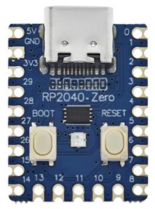

# PiMac 2040 - Apple Macintosh 128K/208K para RP2040-Zero
### Desenvolvimento, Adaptação e Engenharia por [SCHUBIGER.CL](https://schubiger.cl)

<p align="center">
  <strong>🌐 Idiomas / Languages / Sprachen / 语言 / Langues:</strong><br>
  <a href="README.md">🇪🇸 Español</a> |
  <a href="README_EN.md">🇬🇧 English</a> |
  <a href="README_PT.md"><strong>🇵🇹 Português</strong></a> |
  <a href="README_DE.md">🇩🇪 Deutsch</a> |
  <a href="README_ZH.md">🇨🇳 中文</a> |
  <a href="README_FR.md">🇫🇷 Français</a>
</p>

<p align="center">
  
  &nbsp;&nbsp;&nbsp;&nbsp;
  
</p>

> [!TIP]
> **Quer montar e testar em 5 minutos?**
> Consulte o [**Guia Rápido de Instalação e Montagem de Hardware para o Release (RELEASE_README_PT.md)**](RELEASE_README_PT.md), com o passo a passo simplificado para gravar o RP2040, preparar o cartão MicroSD e escolher entre a **Versão 1 (Apenas Vídeo Composto)** ou a **Versão 2 (Dual VGA + Vídeo Composto)** com a lista completa de componentes.

**PiMac 2040** é uma reconstrução fiel, minimalista e de baixíssimo custo do emblemático computador **Apple Macintosh de 1984** executado sobre o microcontrolador **Raspberry Pi RP2040** na placa ultracompacta **Waveshare / Tenstar Robot RP2040-Zero** (e equivalentes do AliExpress).

Este projeto incorpora um **motor de vídeo duplo inteligente** (Vídeo Composto analógico para TVs CRT antigas e saída VGA para monitores de PC), expansão de memória para **208 KB de RAM**, suporte de armazenamento em cartão **MicroSD** mediante um adaptador passivo soldado diretamente, diagnóstico visual em tempo real através do **LED RGB WS2812** integrado e conectividade **USB Host**.

---

## 🚀 Principais Características

* **Motor de Vídeo Duplo Selecionável (Composto e VGA):**
  * **Vídeo Composto (CVBS / RCA):** Modo entrelaçado 480i NTSC a 15,734 kHz com DAC passivo de 2 resistores. Imagem centralizada de $512 \times 342$ pixels para televisores de tubo CRT.
  * **Saída VGA (DE-15 / DB-15):** Modo padrão $640 \times 480$ a $60\text{ Hz}$ (31,468 kHz) para monitores LCD ou CRT de computador.
  * **Comutação por Jumper / Chave (GP0):** Sem jumper inicia em Vídeo Composto; com jumper para GND inicia em VGA. Ambos os conectores podem permanecer soldados permanentemente no mesmo aparelho.
* **Memória Expandida para 208 KB ("Mac 208K"):** Aproveita ao máximo a memória SRAM do RP2040, permitindo abrir e trabalhar sem erros de falta de memória no **MacPaint 1.5** e **MacWrite 4.5**.
* **Armazenamento em Cartão MicroSD (FAT32):** Lê e grava dados diretamente em imagens de disco (`umac0.img`) através do barramento SPI. Salve documentos, ilustrações e progresso de jogos de forma permanente.
* **Leitor MicroSD DIY Direto (Sem módulos caros):** Permite soldar 6 fios finos diretamente nos contatos dourados traseiros de qualquer adaptador plástico comercial MicroSD-para-SD.
* **Controlador USB Host Integrado:** Suporte para mouse e teclado USB padrão através da porta USB-C nativa (ou portas USB-A fêmea recicladas soldadas diretamente à placa).
* **Indicador de Estado Retro (LED RGB WS2812 em GP16):** Diagnóstico visual em tempo real:
  * 🟦 **Azul Celeste:** Inicialização do hardware / POST.
  * 🟨 **Âmbar Intermitente (1 Hz):** Aguardando disco (ícone clássico do disquete `?`).
  * 🟧 **Laranja Pulsante:** Inicializando o sistema (Happy Mac / carregamento do kernel).
  * 🟩 **Verde Retro Apple (Respiração):** Desktop / Finder pronto para uso.
  * ⚡ **Flash Âmbar Rápido:** Leitura de setores no MicroSD.
  * 🟪 **Flash Magenta:** Gravação de setores no MicroSD.
  * 🔴 **Vermelho Estroboscópico:** Pânico de sistema / Sad Mac / Erro de bomba.
* **Custo Total Ultrabaixo:** Monte todo o computador retrô por menos de **$5 a $8 dólares (USD)**.

---

## 🗺️ Mapa de Pinos da RP2040-Zero

<p align="center">
  <br>
  <em>Placa base física oficial do projeto: Tenstar Robot / Waveshare RP2040-Zero (18 × 23,5 mm)</em>
</p>

```text
                            +-------------------+
                            |     [ USB-C ]     |
                            | (Host OTG/Flashing|
   +5V (VBUS / 5V DC Ext) 5V [ | (o)           (o) | ] 0   GP0 (Seletor VGA/RCA Switch)
         GND (Massa Geral) GND [ | (o)           (o) | ] 1   GP1 (Livre)
(Pino 4 VDD 3.3V MicroSD) 3V3[ | (o)           (o) | ] 2   GP2 (SD CLK - Clock)
    (HSync VGA DB-15 p.13) 29 [ | (o)  RP2040   (o) | ] 3   GP3 (SD TX - MOSI)
         (CLK Opcional)   28 [ | (o)   -Zero   (o) | ] 4   GP4 (SD RX - MISO)
    (VSync VGA DB-15 p.14) 27 [ | (o)  +-----+  (o) | ] 5   GP5 (SD CS - Chip Select)
 (Vídeo VGA 100Ω p.1,2,3) 26 [ | (o)           (o) | ] 6   GP6 (Livre)
                 (Livre)  15 [ | (o) [BOOT] [RST] (o)| ] 7   GP7 (Livre)
                 (Livre)  14 [ | (o)           (o) | ] 8   GP8 (CVBS Sync 560Ω -> RCA)
                               +-------------------+
                                  13  12  11  10  9
                                   |   |   |   |  +--> GP9  (CVBS Vídeo 270Ω -> RCA)
                                   |   |   |   +-----> GP10 (USB Teclado D+)
                                   |   |   +---------> GP11 (USB Teclado D-)
                                   |   +-------------> GP12 (USB Mouse D+)
                                   +-----------------> GP13 (USB Mouse D-)
```

---

## 📺 Conexões Rápidas de Vídeo

### Versão 1: Apenas Vídeo Composto (RCA Amarelo para TV CRT)
[](assets/pimac2040_version1_composite.jpg)

* **GP8 (Sync):** Resistor de **$560\,\Omega$** (1/4 W, Verde-Azul-Marrom) conectado ao pino central do conector RCA fêmea.
* **GP9 (Data):** Resistor de **$270\,\Omega$** (1/4 W, Vermelho-Violeta-Marrom) conectado ao pino central do conector RCA fêmea.
* **GND:** Conectado diretamente à carcaça / malha externa do conector RCA.

---

### Versão 2: Dual VGA + Vídeo Composto (Monitor de PC e TV CRT)
[](assets/pimac2040_version2_dual_vga_composite.jpg)

* **GP26 (Vídeo Monocromático):** Resistor de **$100\,\Omega$** (1/4 W, Marrom-Preto-Marrom) conectado aos pinos **1, 2 e 3 (Vermelho, Verde e Azul unidos)** do conector VGA DE-15 fêmea.
* **GP27 (VSync):** Conectado diretamente ao pino **14** do conector VGA.
* **GP29 (HSync):** Conectado diretamente ao pino **13** do conector VGA.
* **GND:** Conectado aos pinos **5, 6, 7, 8 e 10** do conector VGA.
* **Comutação:** Ligue uma chave SPDT ou jumper entre **GP0** e **GND**: fechado para GND inicia em VGA; aberto inicia em Vídeo Composto.

---

## ⚡ Guia de Instalação Rápida (10 Segundos)

1. Baixe o firmware pré-compilado: [`release/PiMac2040_DualVideo_RP2040Zero.uf2`](release/PiMac2040_DualVideo_RP2040Zero.uf2).
2. Mantenha pressionado o botão **BOOT** da RP2040-Zero e conecte-a ao computador via USB.
3. Uma unidade de armazenamento com o nome **`RPI-RP2`** será aberta.
4. Arraste e solte o arquivo `.uf2` na unidade. A placa gravará o firmware e reiniciará sozinha.
5. Copie qualquer imagem de disco da pasta [`disks/`](disks/) para a raiz do seu cartão MicroSD (formatado em FAT32) e renomeie-a para **`umac0.img`**.
6. Conecte ao seu monitor ou televisor e aproveite o clássico Macintosh de 1984!

---

## 💾 Catálogo de Imagens de Disco Prontas para Usar

Na pasta [`disks/`](disks/) você encontrará uma coleção completa de imagens com suporte a leitura e gravação:

| Imagem | Tamanho | SO | Conteúdo e Aplicativos em Destaque |
| :--- | :---: | :---: | :--- |
| **`umac0_oficina_almacenamiento_20mb.img`** | **20 MB** | System 3.2 | **Produtividade e Armazenamento:** Microsoft Word 4.0a, Microsoft Excel 2.2a, Microsoft Works 3.0, Aldus PageMaker 2.0a, MacPaint 2.0, MacDraw 1.9, TeachText, BBEdit Lite, utilitários e pasta **📁 Meus Documentos** com mais de 10 MB livres. |
| **`umac0_aventura_juegos_15mb.img`** | **15 MB** | System 3.2 | **Aventura e Estratégia:** Prince of Persia (BW), SimCity 1.11 com cenários, Tetris oficial com áudio, Dark Castle, Beyond Dark Castle, Stunt Copter, Shufflepuck Café, Risk, Cannon Fodder e pasta **📁 Meus Jogos Salvos** com mais de 8 MB livres. |
| **`umac0_master_10mb.img`** | 10 MB | System 3.2 | **Tudo-em-Um:** Dark Castle, Beyond Dark Castle, Stunt Copter, Shufflepuck Café, Risk, Cannon Fodder, Tetris DA, MacPaint, MacDraw, TeachText, Disk Copy, Utilitários. |
| **`umac0.img`** | 10 MB | System 3.2 | **Clássico Original:** MacPaint 1.3, MacWrite 4.5, MacDraw, Lode Runner, Aliens, Billiard Parlour, Mouse Eaters, DaliClock, Planetfall, MacLanding, Enigma. |
| **`umac0_games_pack.img`** | 4 MB | System 3.2 | **Pacote Arcade:** Dark Castle v1.2, Beyond Dark Castle, Stunt Copter, Shufflepuck Café, Risk, Cannon Fodder, Tetris DA. |
| **`umac0_productivity.img`** | 800 KB | System 3.2 | **Escritório e Design:** MacPaint, MacDraw, TeachText, Disk Copy, Draw Tour, Woodblock. |
| **`umac0_dark_castle.img`** | 800 KB | Autônomo | **Dark Castle v1.2:** Lendário jogo de plataforma da Silicon Beach Software. |
| **`umac0_beyond_dark_castle.img`** | 800 KB | Autônomo | **Beyond Dark Castle:** Sequência épica com jetpack, bombas e salas secretas. |
| **`umac0_stunt_copter.img`** | 800 KB | Autônomo | **Stunt Copter:** Clássico com física real de Duane Blehm (v1.0 a 2.0). |
| **`umac0_system11_1984.img`** | 400 KB | System 1.1 | **Macintosh 128K 1984:** O sistema original apresentado por Steve Jobs no lançamento em 1984. |
| **`umac0_system32_utilities.img`** | 800 KB | System 3.2 | **Apple Utilities:** Font/DA Mover, fontes históricas e ferramentas oficiais de disco. |

> [!TIP]
> **Para alternar discos:** Consulte o [**Guia Completo de Discos MicroSD (disks/README_PT.md)**](disks/README_PT.md) para aprender a formatar, copiar sistemas e salvar partidas.

---

## 💻 Código-Fonte e Arquitetura

O código-fonte completo está localizado em [`src/`](src/):
* [`src/main.c`](src/main.c): Ponto de entrada, overclock para 240 MHz, inicialização de memória e loop principal.
* [`src/mac_display_composite.c`](src/mac_display_composite.c): Gerador DMA de vídeo composto monocromático NTSC 480i.
* [`src/mac_display.c`](src/mac_display.c): Controlador de vídeo VGA padrão 640x480 @ 60Hz.
* [`src/mac_status.c`](src/mac_status.c): Driver de animações e cores do LED RGB WS2812.
* [`src/hid.c`](src/hid.c): Mapeamento de teclado USB e eventos de mouse.

---

## 📚 Documentação Adicional

* [**Guia Rápido de Instalação e Montagem de Hardware**](RELEASE_README_PT.md)
* [**Guia Completo de Imagens de Disco MicroSD**](disks/README_PT.md)
* [**Guia Técnico de Pinagem e Ligações Elétricas**](GUIA_HARDWARE_PINOUT.md)
* [**Guia de Compilação do Firmware**](GUIA_COMPILACION.md)
* [**Lista de Materiais (BOM) e Onde Comprar**](BOM_LISTA_MATERIALES.md)

---

## 📜 Licença Aberta e Atribuição

Este projeto é compartilhado abertamente com a comunidade sob os termos da **Licença MIT**.

Você tem total liberdade para estudar, modificar, manipular, compilar e redistribuir tanto o software quanto o projeto de hardware para fins pessoais, educacionais ou comerciais. Caso utilize este trabalho em suas próprias criações, agradecemos a citação e menção ao desenvolvimento original de [SCHUBIGER.CL](https://schubiger.cl).

Para mais detalhes sobre os termos legais, consulte o arquivo [LICENSE](LICENSE).
