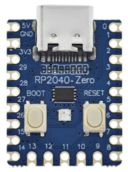

# PiMac 2040 - 基于 RP2040-Zero 的 Apple Macintosh 128K/208K 复刻项目
### 由 [SCHUBIGER.CL](https://schubiger.cl) 开发、适配与工程实现

<p align="center">
  <strong>🌐 语言 / Languages / Idiomas / Sprachen / Langues:</strong><br>
  <a href="README.md">🇪🇸 Español</a> |
  <a href="README_EN.md">🇬🇧 English</a> |
  <a href="README_PT.md">🇵🇹 Português</a> |
  <a href="README_DE.md">🇩🇪 Deutsch</a> |
  <a href="README_ZH.md"><strong>🇨🇳 中文</strong></a> |
  <a href="README_FR.md">🇫🇷 Français</a>
</p>

<p align="center">
  
  &nbsp;&nbsp;&nbsp;&nbsp;
  
</p>

> [!TIP]
> **想要在 5 分钟内快速搭建并体验？**
> 请参阅 [**快速安装与硬件组装指南 (RELEASE_README_ZH.md)**](RELEASE_README_ZH.md)，内含超简单的固件刷入步骤、MicroSD 卡准备流程，以及在**版本 1（纯复合视频）**与**版本 2（双路 VGA + 复合视频）**之间的选择和元器件采购清单（BOM）。

**PiMac 2040** 是一项忠实、极简且超低成本的经典 **1984 年 Apple Macintosh** 个人电脑复刻项目。它运行在 **Raspberry Pi RP2040** 微控制器上，并适配超紧凑的 **Waveshare / Tenstar Robot RP2040-Zero** 开发板（以及在各大电商平台均能购得的兼容版本）。

本项目具备**智能双路视频输出引擎**（适用于老式 CRT 电视的模拟复合视频，以及适用于 PC 显示器的标准 VGA 接口）、扩展至 **208 KB 的内存 (RAM)**、通过直接焊接的无源转换套卡实现的持久化 **MicroSD 卡存储**、通过板载 **WS2812 RGB LED** 实现的实时硬件状态诊断，以及原生 **USB Host** 主机功能。

---

## 🚀 核心特性

* **可选双路视频引擎（复合视频与 VGA）：**
  * **复合视频 (CVBS / RCA)：** 480i NTSC 隔行扫描模式（行频 15.734 kHz），使用 2 颗电阻构成的无源 DAC，输出 $512 \times 342$ 像素居中图像，完美适配老式 CRT 显像管电视。
  * **VGA 输出 (DE-15 / DB-15)：** 标准 $640 \times 480$ @ $60\text{ Hz}$（行频 31.468 kHz），适配现代 LCD 显示器或 CRT 电脑显示器。
  * **跳线/开关即时切换 (GP0)：** 悬空/无跳线启动进入复合视频模式；接地 (GND) 启动进入 VGA 模式。两种接口可永久焊接在同一设备上。
* **内存扩充至 208 KB（"Mac 208K"）：** 深度榨干 RP2040 的内置 SRAM，支持无内存溢出地流畅运行 **MacPaint 1.5** 和 **MacWrite 4.5**。
* **MicroSD 卡持久化存储 (FAT32)：** 借助 SPI 总线直接读写磁盘原始镜像文件 (`umac0.img`)，永久保存您的文档、画作与游戏存档。
* **极简 DIY MicroSD 改造（无需昂贵模块）：** 只需将 6 根细飞线直接焊接在常规 MicroSD 转 SD 大卡套背部的金色触点上即可。
* **集成 USB Host 主机控制器：** 支持标准 USB 鼠标和键盘，既可使用板载 USB-C 口，亦可外接废旧 USB-A 母口焊接至 GPIO。
* **复古 RGB 状态指示灯（GP16 上的 WS2812）：**
  * 🟦 **天蓝色：** 硬件初始化 / POST 自检。
  * 🟨 **黄色闪烁 (1 Hz)：** 等待磁盘（经典的软盘问号 `?` 图标）。
  * 🟧 **橙色脉动：** 系统引导中（Happy Mac 笑脸 / 内核加载）。
  * 🟩 **Apple 复古绿（呼吸）：** 系统桌面 / Finder 就绪可用。
  * ⚡ **快速黄色频闪：** 正在从 MicroSD 读取扇区。
  * 🟪 **品红频闪：** 正在向 MicroSD 写入扇区。
  * 🔴 **红色爆闪：** 系统崩溃 / Sad Mac 哭脸 / 炸弹错误。
* **超低 BOM 物料成本：** 整套复古电脑的物料成本不足 **5 至 8 美元 (USD)**。

---

## 🗺️ RP2040-Zero 引脚定义图

<p align="center">
  <br>
  <em>项目官方硬件核心板：Tenstar Robot / Waveshare RP2040-Zero (18 × 23.5 mm)</em>
</p>

```text
                            +-------------------+
                            |     [ USB-C ]     |
                            | (Host OTG/刷机接口 |
    +5V (VBUS / 5V外部供电) 5V [ | (o)           (o) | ] 0   GP0 (VGA/RCA 模式切换跳线)
         GND (系统总地线)  GND[ | (o)           (o) | ] 1   GP1 (空闲)
(MicroSD 4脚 VDD 3.3V)   3V3[ | (o)           (o) | ] 2   GP2 (SD CLK - 时钟线)
    (VGA DB-15 13脚 HSync) 29 [ | (o)  RP2040   (o) | ] 3   GP3 (SD TX - MOSI主机输出)
         (可选时钟)        28 [ | (o)   -Zero   (o) | ] 4   GP4 (SD RX - MISO主机输入)
    (VGA DB-15 14脚 VSync) 27 [ | (o)  +-----+  (o) | ] 5   GP5 (SD CS - 片选信号)
 (VGA 100Ω接1,2,3脚视频)   26 [ | (o)           (o) | ] 6   GP6 (空闲)
                 (空闲)   15 [ | (o) [BOOT] [RST] (o)| ] 7   GP7 (空闲)
                 (空闲)   14 [ | (o)           (o) | ] 8   GP8 (CVBS 同步 560Ω -> RCA)
                               +-------------------+
                                  13  12  11  10  9
                                   |   |   |   |  +--> GP9  (CVBS 图像 270Ω -> RCA)
                                   |   |   |   +-----> GP10 (USB 键盘 D+)
                                   |   |   +---------> GP11 (USB 键盘 D-)
                                   |   +-------------> GP12 (USB 鼠标 D+)
                                   +-----------------> GP13 (USB 鼠标 D-)
```

---

## 📺 快速视频接线方案

### 版本 1：纯复合视频（黄色 RCA 莲花头，适用于 CRT 显像管电视）
[](assets/pimac2040_version1_composite.jpg)

* **GP8 (Sync 同步)：** **$560\,\Omega$** 电阻（1/4 W，色环：绿-蓝-棕）连接到 RCA 莲花头的中心正极针脚。
* **GP9 (Data 图像)：** **$270\,\Omega$** 电阻（1/4 W，色环：红-紫-棕）连接到 RCA 莲花头的中心正极针脚。
* **GND：** 直接连接到 RCA 莲花头的外层金属屏蔽地线焊片。

---

### 版本 2：双路 VGA + 复合视频（电脑显示器与 CRT 电视兼顾）
[](assets/pimac2040_version2_dual_vga_composite.jpg)

* **GP26 (黑白视频)：** **$100\,\Omega$** 电阻（1/4 W，色环：棕-黑-棕）并联接入 VGA DE-15 母头的 **1、2、3 号引脚（红、绿、蓝三色短接）**。
* **GP27 (VSync 场同步)：** 直连 VGA 母头的 **14** 号针脚。
* **GP29 (HSync 行同步)：** 直连 VGA 母头的 **13** 号针脚。
* **GND：** 连接至 VGA 母头的 **5、6、7、8 与 10** 号地线脚及金属外壳。
* **显示切换：** 在 **GP0** 与 **GND** 之间接一个微型开关或跳线：闭合接地启动为 VGA 模式；断开悬空启动为复合视频模式。

---

## ⚡ 10 秒极速刷机指南

1. 下载现成的预编译固件：[`release/PiMac2040_DualVideo_RP2040Zero.uf2`](release/PiMac2040_DualVideo_RP2040Zero.uf2)。
2. 按住 RP2040-Zero 板上的 **BOOT** 按钮不放，通过 USB 插入电脑。
3. 电脑中将弹出一个名为 **`RPI-RP2`** 的大容量存储盘。
4. 将 `.uf2` 文件直接拖拽至该盘符中，开发板将自动烧录并重启。
5. 将 [`disks/`](disks/) 目录中的任一磁盘镜像拷贝至 FAT32 格式的 MicroSD 卡根目录，并重命名为 **`umac0.img`**。
6. 接上电视或显示器，即可尽情体验 1984 年的经典 Macintosh 系统！

---

## 💾 开箱即用磁盘镜像全集

在 [`disks/`](disks/) 目录下，提供了一套包含读写支持的完整磁盘镜像库：

| 镜像文件名 | 容量 | 操作系统 | 核心应用与特色内容 |
| :--- | :---: | :---: | :--- |
| **`umac0_oficina_almacenamiento_20mb.img`** | **20 MB** | System 3.2 | **办公效率与大容量存储：** Microsoft Word 4.0a, Microsoft Excel 2.2a, Microsoft Works 3.0, Aldus PageMaker 2.0a, MacPaint 2.0, MacDraw 1.9, TeachText, BBEdit Lite 以及 **📁 我的文档** 目录（拥有超过 10 MB 剩余存储空间）。 |
| **`umac0_aventura_juegos_15mb.img`** | **15 MB** | System 3.2 | **冒险与策略游戏特辑：** 波斯王子黑白版 (Prince of Persia), 模拟城市 1.11 全关卡 (SimCity), 官方声音俄罗斯方块 (Tetris), 黑暗城堡 (Dark Castle), 城堡飞跃 (Beyond Dark Castle), 直升机特技 (Stunt Copter), 飞碟咖啡馆 (Shufflepuck Café), 战国风云 (Risk), 炮灰 (Cannon Fodder) 与 **📁 我的游戏存档** 目录（拥有超过 8 MB 剩余空间）。 |
| **`umac0_master_10mb.img`** | 10 MB | System 3.2 | **全能合辑：** Dark Castle, Beyond Dark Castle, Stunt Copter, Shufflepuck Café, Risk, Cannon Fodder, Tetris DA, MacPaint, MacDraw, TeachText, Disk Copy, 系统工具。 |
| **`umac0.img`** | 10 MB | System 3.2 | **原汁原味经典盘：** MacPaint 1.3, MacWrite 4.5, MacDraw, 淘金者 (Lode Runner), 异形 (Aliens), 桌球 (Billiard Parlour), 吃豆鼠 (Mouse Eaters), 达利钟 (DaliClock), 悬星历险 (Planetfall), 月球着陆 (MacLanding), 谜语 (Enigma)。 |
| **`umac0_games_pack.img`** | 4 MB | System 3.2 | **街机游戏包：** Dark Castle v1.2, Beyond Dark Castle, Stunt Copter, Shufflepuck Café, Risk, Cannon Fodder, Tetris DA。 |
| **`umac0_productivity.img`** | 800 KB | System 3.2 | **办公设计盘：** MacPaint, MacDraw, TeachText, Disk Copy, Draw Tour, Woodblock。 |
| **`umac0_dark_castle.img`** | 800 KB | 独立引导 | **黑暗城堡 v1.2 (Dark Castle)：** Silicon Beach Software 的传奇平台跳跃动作神作。 |
| **`umac0_beyond_dark_castle.img`** | 800 KB | 独立引导 | **城堡飞跃 (Beyond Dark Castle)：** 加入喷气背包、炸弹与秘密房间的绝妙续作。 |
| **`umac0_stunt_copter.img`** | 800 KB | 独立引导 | **特技直升机 (Stunt Copter)：** Duane Blehm 经典物理力学名作（v1.0 至 2.0）。 |
| **`umac0_system11_1984.img`** | 400 KB | System 1.1 | **Macintosh 128K 1984 原版系统：** 史蒂夫·乔布斯在 1984 年发布会上亲自展示的历史镜像。 |
| **`umac0_system32_utilities.img`** | 800 KB | System 3.2 | **Apple 实用工具盘：** 包含 Font/DA Mover 字体工具、历史字体与官方磁盘检测套件。 |

> [!TIP]
> **更换磁盘系统：** 请查阅 [**MicroSD 磁盘使用手册 (disks/README_ZH.md)**](disks/README_ZH.md)，了解如何格式化、替换镜像及管理存档。

---

## 💻 源代码与架构解析

完整源代码存放在 [`src/`](src/) 目录中：
* [`src/main.c`](src/main.c)：系统入口，配置 240 MHz 超频，初始化内存与主模拟调度循环。
* [`src/mac_display_composite.c`](src/mac_display_composite.c)：基于 DMA 的 NTSC 480i 黑白复合视频信号生成驱动。
* [`src/mac_display.c`](src/mac_display.c)：标准 640x480 @ 60Hz VGA 视频驱动。
* [`src/mac_status.c`](src/mac_status.c)：板载 WS2812 RGB LED 多彩状态动画驱动。
* [`src/hid.c`](src/hid.c)：USB 键盘与鼠标扫描码协议映射与转换。

---

## 📚 延伸技术文档

* [**快速安装与硬件组装指南**](RELEASE_README_ZH.md)
* [**MicroSD 磁盘镜像完整使用手册**](disks/README_ZH.md)
* [**硬件引脚定义与电路接线工程图**](GUIA_HARDWARE_PINOUT.md)
* [**固件源码编译与开发指南**](GUIA_COMPILACION.md)
* [**采购元器件清单 (BOM) 与购买参考**](BOM_LISTA_MATERIALES.md)

---

## 📜 开源许可与致谢

本项目基于 **MIT 开源许可证** 向全球创客与开源爱好者社区完全开放。

无论个人、教育还是商业用途，您均可自由研究、修改、二次开发、编译和分发本项目包含的软件代码与硬件设计。如果您基于本项目进行二次创作或分发，请务必保留对原始开发方 [SCHUBIGER.CL](https://schubiger.cl) 的署名和致谢。

完整的法律条款请参阅 [LICENSE](LICENSE) 文件。
