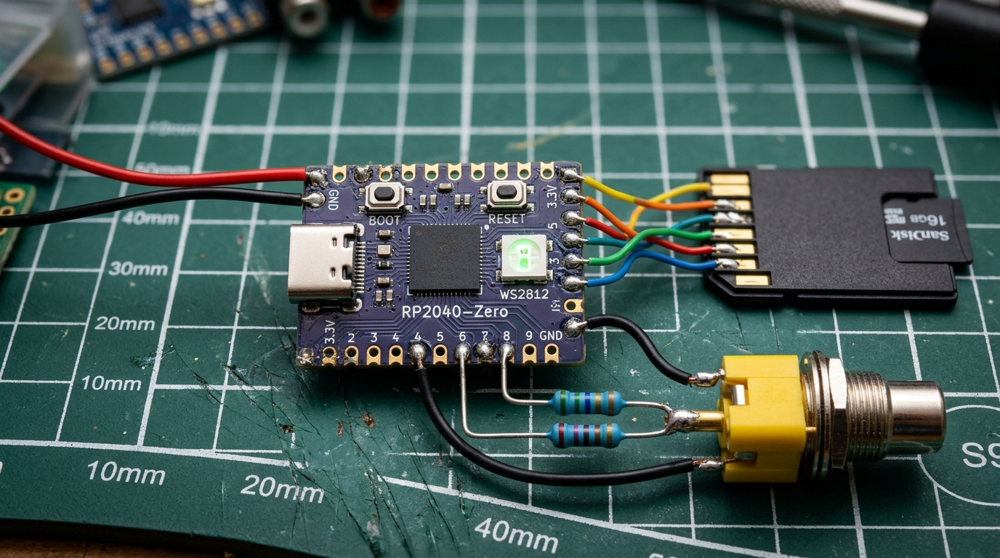
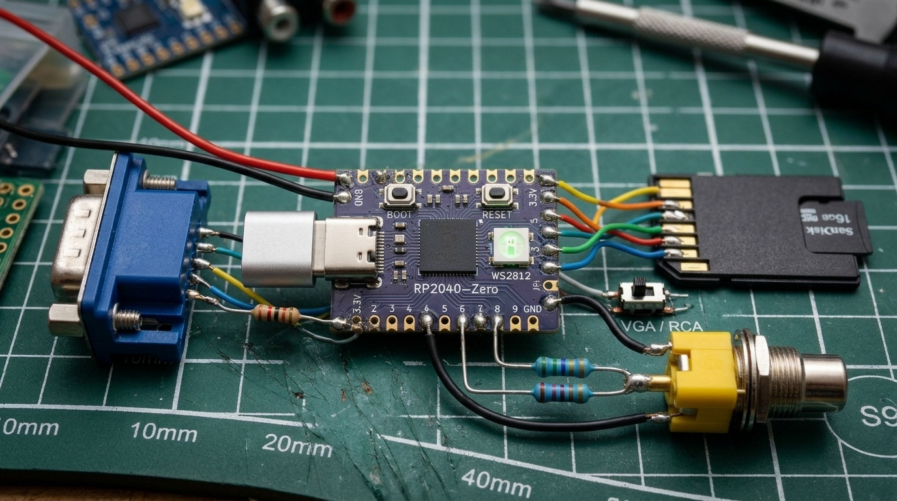

# PiMac 2040 (Macintosh 208K) – 官方硬件组装与安装指南
### [SCHUBIGER.CL](https://schubiger.cl) 开源软件与开源硬件项目
### MIT 开源许可证 – 自由探索、修改与全球分享

<p align="center">
  <strong>🌐 Idiomas / Languages / Sprachen / 语言 / Langues:</strong><br>
  <a href="RELEASE_README.md">🇪🇸 Español</a> |
  <a href="RELEASE_README_EN.md">🇬🇧 English</a> |
  <a href="RELEASE_README_PT.md">🇵🇹 Português</a> |
  <a href="RELEASE_README_DE.md">🇩🇪 Deutsch</a> |
  <a href="RELEASE_README_ZH.md"><strong>🇨🇳 中文</strong></a> |
  <a href="RELEASE_README_FR.md">🇫🇷 Français</a>
</p>


欢迎来到 **PiMac 2040**！本指南以通俗、简练、直观的工程语言编写。即使您此前没有任何单片机开发基础，也能在短短数分钟内将经典 Mac 系统烧录至 **RP2040**，快速接通电路，重温 1984 年 Apple Macintosh 电脑配合鼠标、键盘、MicroSD 存储卡以及电视/电脑显示器输出的纯正复古体验。

---

## ⚡ 1. RP2040 极速系统刷机（仅需 3 步）

无需搭建任何复杂的开发环境，也无需编译源码。固件已预先编译完成，存放在文件 **`release/PiMac2040_DualVideo_RP2040Zero.uf2`** 中：

```text
  [ .UF2 固件文件 ]   ------------------------->  [ RPI-RP2 模拟盘符 ]   ---> 刷机完成！
  (PiMac 2040 系统)          直接拖拽放行                (RP2040 Boot 模式)       (2秒内自动重启)
```

1. **进入 Boot 模式：** 拿起您的 **Waveshare / Tenstar Robot RP2040-Zero**（或树莓派 Pico）开发板。长按板载白色 **BOOT**（或 BOOTSEL）按钮，不要松手，用 USB-C 数据线将其插入电脑，然后松开按钮。
2. **识别移动盘：** 电脑将自动弹出一个名为 **`RPI-RP2`** 的大容量存储盘符（与插入普通 U 盘完全一致）。
3. **复制固件文件：** 将以下文件直接拖拽或复制到 `RPI-RP2` 盘符中：
   👉 **`release/PiMac2040_DualVideo_RP2040Zero.uf2`**
4. **大功告成！** 约 2 秒钟后，板载 LED 将闪烁，文件夹会自动关闭，PiMac 2040 系统便已永久烧录至芯片内部的 Flash 闪存中。

---

## 💾 2. 准备 MicroSD 存储卡与系统磁盘

1. 准备任意一张 MicroSD 卡（容量介于 256 MB 至 32 GB 均可）。
2. 将其接入电脑，格式化为 **FAT32** 格式（快速格式化即可）。
3. 打开项目目录中的 **`disks/`** 文件夹，选择您所需的磁盘镜像：
   * **`umac0_oficina_almacenamiento_20mb.img`：** 完整办公套件（Word 4.0, Excel 2.2, Works 3.0, PageMaker 2.0, MacPaint, MacDraw），在*我的文档*目录下预留了超过 10 MB 剩余空间，可用于持久保存文件。
   * **`umac0_aventura_juegos_15mb.img`：** 冒险与策略游戏全集（波斯王子、模拟城市、官方音频版俄罗斯方块、黑暗城堡等），并在*我的存档*目录下预留了超过 8 MB 剩余空间。
   * **`umac0_master_10mb.img`：** 兼顾游戏、绘图与实用工具的十全大补盘。
4. **将选好的镜像文件复制到 MicroSD 卡的根目录下**，并精准重命名为：
   👉 **`umac0.img`**
5. 将 MicroSD 卡插入 PiMac 2040 的卡槽中。

---

## 🛠️ 3. 硬件版本二选一：您应该选择哪种版本？

PiMac 2040 固件搭载了**智能双路视频引擎**，原生支持复古 CRT 显像管电视与标准电脑显示器：

```text
+-------------------------------------------------------------------------------------------------+
|                                    两款硬件版本横向对比                                         |
+-------------------------------------------------------------------------------------------------+
| 核心指标                       | 版本 1：纯复合视频 (RCA)        | 版本 2：双路 VGA + 复合视频  |
+--------------------------------+---------------------------------+------------------------------+
| 适配显示设备                   | 老式 CRT 电视或莲花头 AV 监视器 | CRT 电视 + PC 电脑显示器     |
| 视频物理接口                   | 1 个黄色 RCA 母头               | 1 个 RCA + 1 个 VGA (DE-15)  |
| 组装难度                       | 极低（仅需 2 颗普通电阻）       | 中等（3 颗电阻 + VGA 接头）  |
| 画面输出模式选择               | 自动输出复合视频                | 通过拨动开关或跳线帽 (GP0)   |
| MicroSD 读写支持               | 支持完整读写与保存              | 支持完整读写与保存           |
| USB 键鼠接入                   | 支持                            | 支持                         |
| 全套元器件采购成本             | 极致低廉（约 4 至 6 美元）      | 极具性价比（约 6 至 8 美元） |
+--------------------------------+---------------------------------+------------------------------+
```

---

## 📺 版本 1：极简经济版（纯复合视频输出）

[](assets/pimac2040_version1_composite.jpg)
*版本 1 真实物理组装图：通过 560 Ω 与 270 Ω 分压电阻连接 RCA 复合视频、MicroSD SPI 改造飞线与 USB 接口。*

### 工作原理
该版本专为将 PiMac 2040 直连老式大屁股显像管电视（CRT）、带有黄色 AV 接口的液晶电视或监视器而设计。

RP2040 微控制器原生输出符合黑白 **NTSC 480i** 标清制式的模拟视频信号。通过 GP8 和 GP9 引脚串联的两颗普通直插电阻，将数字同步脉冲与图像数据以纯硬件形式无源混合，完美合成符合电视机标准的 1.0V 峰峰值、75 Ω 阻抗复合视频信号。

### 复合视频接线图：
```text
   RP2040-Zero (引脚)                            黄色面板安装式 RCA 莲花母头
  +--------------------+                         +------------------------------+
  |                    |      560 Ω (色环：绿-蓝-棕)                            |
  |  GP8 (同步信号)    +-----[1/4W 轴向电阻]--------+                            |
  |                    |                            |                            |
  |                    |      270 Ω (色环：红-紫-棕) |                            |
  |  GP9 (图像数据)    +-----[1/4W 轴向电阻]--------+----> 中心正极引脚 (视频信号)  |
  |                    |                                                         |
  |  GND (系统总地线)  +----------------------------------> 外层金属屏蔽接地焊片   |
  +--------------------+                         +------------------------------+
```

### 元器件购买清单（采购参考标准名称）：
1. **1x 核心开发板：** **Waveshare RP2040-Zero**（或 Tenstar Robot RP2040-Zero）。
2. **1x 面板安装式 RCA 莲花母座：** 黄色绝缘圈（英文搜索：*RCA Female Jack Panel Mount Connector*）。
3. **1x 560 Ω 直插电阻：** 金属膜或碳膜，功率 1/4W 或 1/8W（色环：绿 - 蓝 - 棕 - 金）。
4. **1x 270 Ω 直插电阻：** 金属膜或碳膜，功率 1/4W 或 1/8W（色环：红 - 紫 - 棕 - 金）。
5. **1x 无源 MicroSD 转 SD 大卡卡套**（买内存卡常送的黑色塑料外壳套卡）或 1 个 3.3V MicroSD SPI 读卡模块。
6. **1x USB-C 公头转 USB-A 母头 OTG 转接头**（用于接入键盘鼠标）。

---

## 🖥️ 版本 2：全能双模版（复合视频 + VGA 电脑显示器）

[](assets/pimac2040_version2_dual_vga_composite.jpg)
*版本 2 真实物理组装图：DE-15 VGA 端口（配 100 Ω 匹配电阻）、RCA 莲花母头、SPDT 切换开关及 MicroSD SPI 改造全貌。*

### 智能双路视频引擎如何运作？
固件会在系统通电瞬间检测 **GP0** 引脚的电气电平：
* **GP0 悬空（不接任何电路）：** PiMac 2040 以 **复合视频模式** 启动，通过 RCA 端口输出 15.734 kHz 的 NTSC 信号（适配 CRT 电视）。
* **GP0 接地（拉低至 GND）：** PiMac 2040 自动切入 **标准 VGA 模式**，通过 DE-15 端口输出 640x480 @ 60 Hz (31.468 kHz) 信号（适配 PC 显示器）。

两种接口可同时焊在一块底板上，通过一个微型拨动开关即可在桌面显示器与客厅老电视之间随心切换！

### 双路接线原理图（VGA + 复合视频）：
```text
   RP2040-Zero (引脚)                            DE-15 / DB-15 VGA 15针母座
  +--------------------+                         +-----------------------------------+
  |  GP26 (视频图像)   +-----[ 100 Ω (1/4W) ]----+----> 1、2、3 号引脚（红、绿、蓝三色短接）
  |  GP27 (场同步VS)   +-------------------------> 14 号引脚 (VSync 垂直同步)
  |  GP29 (行同步HS)   +-------------------------> 13 号引脚 (HSync 水平同步)
  |  GND (地线)        +-------------------------> 5、6、7、8 与 10 号地线引脚及金属外壳
  +--------------------+                         +-----------------------------------+

   显示模式切换选择器：
  +--------------------+                         +-----------------------------------+
  |  GP0               +----> [ SPDT 微型开关 ] --> GND (地线)
  |                    |      断开悬空：启动进入复合视频模式 (CRT 电视)
  |                    |      闭合接地：启动进入 VGA 模式 (PC 显示器)
  +--------------------+                         +-----------------------------------+

   复合视频 RCA 端口（可同时并存）：
  +--------------------+                         +-----------------------------------+
  |  GP8 (同步信号)    +-----[ 560 Ω (1/4W) ]----+
  |  GP9 (图像数据)    +-----[ 270 Ω (1/4W) ]----+----> RCA 莲花头中心正极引脚
  |  GND (地线)        +------------------------------> RCA 莲花头外层金属接地焊片
  +--------------------+                         +-----------------------------------+
```

### 版本 2 新增元器件清单：
1. **版本 1 所需的全部物料**（RP2040-Zero、RCA 头、560 Ω 与 270 Ω 电阻、MicroSD 及 USB）。
2. **1x 面板安装式 3 排 15 针 DE-15 / DB-15 VGA 母座**（英文搜索：*VGA DB15 Female 3-Row D-Sub Connector*）。
3. **1x 100 Ω 直插电阻：** 金属膜或碳膜，功率 1/4W 或 1/8W（色环：棕 - 黑 - 棕 - 金）。
4. **1x 单刀双掷 (SPDT) 微型滑动开关** 或 2 脚 2.54mm 跳线帽（英文搜索：*SPDT Mini Slide Switch 3 Pin*）。

---

## 💾 4. MicroSD 卡 SPI 接线改造指南

您可以购买现成的 3.3V MicroSD 模块，也可直接使用常规 **MicroSD 转 SD 大卡卡套** 背部的裸露金手指触点手工飞线：

```text
       RP2040-Zero                               常规 SD 卡套背部金色触点
   +-----------------------+                    +------------------------------------+
   |   GP5 (片选 CS)       +------------------->| 1 号触点 (CD/DAT3)                 |
   |   GP3 (主机输出 MOSI) +------------------->| 2 号触点 (CMD / MOSI)              |
   |   GND (地线)          +------------------->| 3 号触点 (VSS1 / 地)               |
   |   3V3 (3.3伏供电)     +------------------->| 4 号触点 (VDD)  ⚠️ 严禁接入5V电源！  |
   |   GP2 (时钟 SCK)      +------------------->| 5 号触点 (CLK / 时钟)              |
   |   GND (地线)          +------------------->| 6 号触点 (VSS2 / 地)               |
   |   GP4 (主机输入 MISO) +------------------->| 7 号触点 (DAT0 / MISO)             |
   +-----------------------+                    +------------------------------------+
```

> [!CAUTION]
> MicroSD 卡的电源脚 **只能连接至开发板的 3V3 (3.3V) 引脚**。**绝对不能**接到 5V 引脚上，否则将瞬间烧毁您的存储卡！

---

## 🖱️ 5. 键鼠 USB 接口连接方式

PiMac 2040 采用纯硬件 PIO 模拟出 **USB Host 主机接口**：

```text
       RP2040-Zero                               双联 USB-A 母座
   +-----------------------+                    +-------------------------------------+
   |   5V (VBUS 供电)      +------------------->| 1 脚 (+5V 供电) [两个端口并联]      |
   |                       |                    +-------------------------------------+
   |                       |                    | 端口 1 (USB 键盘)：                 |
   |   GP10                +----[ 27 Ω ]--------+ 3 脚: D+ (数据正)                   |
   |                       |          |         |                                     |
   |                       |       [ 15 kΩ ]    |                                     |
   |                       |          |         |                                     |
   |   GP11                +----[ 27 Ω ]--------+ 2 脚: D- (数据负)                   |
   |                       |          |         +-------------------------------------+
   |                       |       [ 15 kΩ ]    | 端口 2 (USB 鼠标)：                 |
   |   GP12                +----[ 27 Ω ]--------+ 3 脚: D+ (数据正)                   |
   |                       |          |         |                                     |
   |                       |       [ 15 kΩ ]    |                                     |
   |                       |          |         |                                     |
   |   GP13                +----[ 27 Ω ]--------+ 2 脚: D- (数据负)                   |
   |                       |          |         |                                     |
   |                       |       [ 15 kΩ ]    |                                     |
   |                       |          |         |                                     |
   |   GND (地线)          +----------+---------+ 4 脚: GND (地线) [两个端口并联]     |
   +-----------------------+                    +-------------------------------------+
```

* **外设兼容性：** 广泛支持市面上几乎所有符合 USB HID 规范的有线键鼠，以及带 2.4 GHz USB 接收器的无线键鼠套装。
* **USB-C OTG 极简用法：** 亦可通过一枚小巧的 OTG 转接头将键盘直接插入板载 USB-C 接口使用。

---

## 🚦 6. 板载 WS2812 RGB LED 状态指示说明 (GP16)

板载彩色 LED 可作为实时系统硬件诊断看板：

| 灯光颜色 | 显示状态 | 硬件含义 |
| :--- | :--- | :--- |
| 🟧 **柔和橙色** | 缓慢脉动 | 系统正在引导启动，读取 Macintosh Plus ROM 固件。 |
| 🟩 **常亮绿色** | 缓慢呼吸 | **系统就绪！** Finder 桌面已经完全载入并等待您的操作。 |
| 🟨 **明亮黄色** | 快速连闪 | 正在从 MicroSD 存储卡读取数据扇区。 |
| 🟪 **亮丽品红** | 快速连闪 | **正在向 MicroSD 写入数据：** 正在保存文档、绘画或游戏存档。 |
| 🔴 **警示红色** | 持续警示闪烁 | MicroSD 卡读取异常：请检查 SPI 接线或确认存储卡是否已格式化为 FAT32 且含有 `umac0.img`。 |

---

## 🔋 7. 系统供电方案

1. **通过 USB-C 供电：** 最简单便捷。将 RP2040-Zero 的 USB-C 端口连接至普通手机充电头（5V / 1A 或 2A）。
2. **通过 5V 稳压直流供电：** 将 5V 正极接到标注为 **`5V` (VBUS)** 的焊盘，负极接到 **`GND`**。
3. **锂电池便携供电：** 搭配一片带有 5V 升压功能的 **TP4056 充放电一体板**，即可外接 3.7V 18650 锂电池构建便携式复古电脑。

---

## 📜 开源许可与致谢

本项目作为开源软件与硬件项目，遵循 **MIT 开源许可证** 全球分发。您可以自由使用、研读、二次开发与分享。

由 **[SCHUBIGER.CL](https://schubiger.cl)** 倾心设计、优化并撰写文档。在任何衍生版本中，我们衷心感谢您保留对原始开发团队的致谢。
